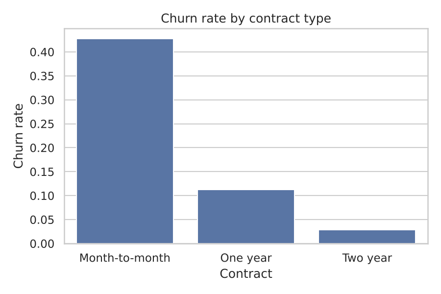
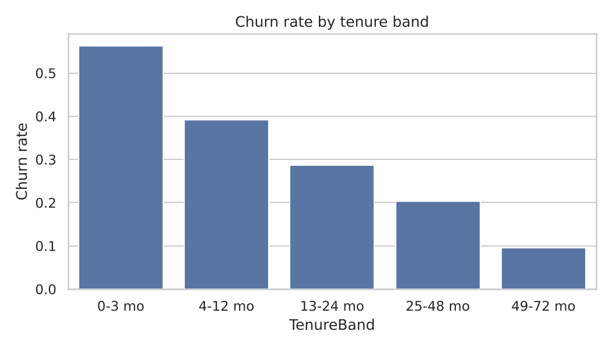
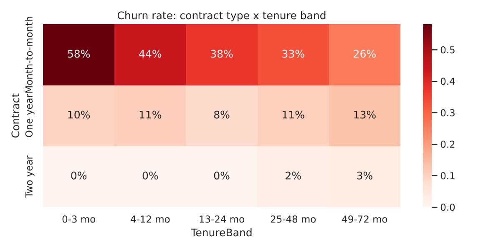
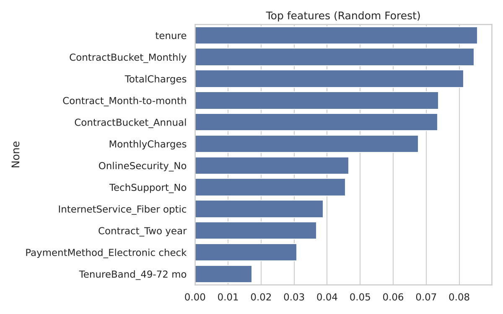

# Customer Churn Analysis (Telco)

Python + Machine Learning project that finds which telecom customers are most likely to churn and why.

**Dataset:** [IBM Telco Customer Churn](https://www.kaggle.com/datasets/blastchar/telco-customer-churn) (7,043 customers, 21 columns).

## What this project does
1. Cleans the data (fixes blank `TotalCharges`, encodes the target).
2. Engineers features: tenure bands, contract buckets (Monthly vs Annual), monthly-charge bands, number of add-on services.
3. Runs EDA and saves 11+ charts (histograms, box plots, heatmaps, churn-rate bar charts).
4. Trains Logistic Regression and Random Forest and compares them (precision, recall, F1, ROC-AUC).

## How to run
```bash
git clone https://github.com/<your-username>/customer-churn-analysis.git
cd customer-churn-analysis
pip install -r requirements.txt
# download the CSV from Kaggle and place it at:
# data/WA_Fn-UseC_-Telco-Customer-Churn.csv
python churn_analysis.py
```
Outputs are written to `outputs/` (`key_stats.json`, `model_results.csv`, `figures/`).

## Key findings
Results on the full dataset (7,043 customers; 1,869 churned):

- Overall churn rate: **26.5%**.
- **88.6%** of churned customers were on **month-to-month contracts**. Churn rate by contract: **42.7%** month-to-month vs **11.3%** one-year vs **2.8%** two-year.
- Churn falls sharply with tenure: **56.2%** of customers in their first 3 months churned, vs **9.5%** of those with 4+ years.
- **26.8%** of all churned customers were on a monthly contract with under 3 months of tenure.
- Fiber optic customers churn more (**41.9%**) than DSL (**19.0%**) and no-internet customers (**7.4%**).

### Model results (20% hold-out test set)
| Model | Accuracy | Precision (churn) | Recall (churn) | F1 (churn) | ROC-AUC |
|---|---|---|---|---|---|
| Logistic Regression | 0.737 | 0.503 | 0.791 | 0.615 | **0.846** |
| Random Forest | 0.757 | 0.530 | 0.767 | 0.627 | 0.841 |

Both models use class weights to handle the imbalance (26.5% churners). Logistic Regression has the best ROC-AUC and catches the most churners (recall 0.79); Random Forest is slightly more accurate overall.

## Business recommendations
- Offer incentives to move month-to-month customers to annual contracts.
- Run onboarding and early-engagement campaigns in the first 3 months, when churn is highest.
- Investigate service quality and pricing for fiber optic customers, who churn at twice the rate of DSL customers.

## Charts





## Tech stack
Python, Pandas, NumPy, Scikit-learn, Matplotlib, Seaborn

## Project structure
```
customer-churn-analysis/
├── churn_analysis.py
├── requirements.txt
├── data/            # place the CSV here (not committed)
└── outputs/         # figures + metrics generated by the script
```
